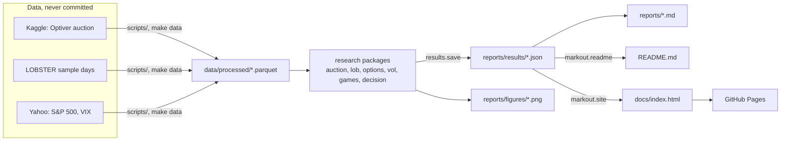
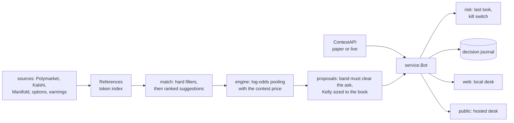

# Architecture

Markout is a research codebase with three products built on top of it: the `markout`
command, a static site, and a trading desk that runs locally or hosted. This page explains
how the parts fit together, the decisions behind them, and how each is tested. For how to
*use* the tools, see [USAGE.md](USAGE.md).

## The pipeline: every number comes from code



Raw data stays on the machine that downloaded it (Kaggle's and LOBSTER's terms), and the
download scripts verify what they fetch. Everything downstream is derived and committed:
each report writes a JSON results file, and the Markdown reports, the README and the site
are rendered from those files, never typed by hand. So a clone without any data can still
rebuild the README and the site, and `tests/test_docs.py` fails if the committed page
differs from what the generator builds.

Results files round floats to 12 significant digits, because multithreaded sums differ in
the last bits from run to run and committed files should only change when a result does.

## Research packages

| Package | What it holds |
|---|---|
| `markout.auction` | Optiver closing-auction data: audit, leakage-safe features, walk-forward models (report 01) |
| `markout.backtest` | Costs, the trading rule, sizing and daily PnL for the auction strategy |
| `markout.lob` | LOBSTER loader, order-flow imbalance, the queue-position fill simulator, markouts, post-or-cross (report 02) |
| `markout.games` | Glosten–Milgrom, Kyle, a market-making tournament, Kuhn poker CFR, a card game (report 03) |
| `markout.options` | Black–Scholes, delta-hedging simulation, the SPY smile (report 04) |
| `markout.decision` | Calibration, value of information, Kelly, the contest study, the decision journal (report 05) |
| `markout.vol` | Variance risk premium, HAR forecast, sizing with ruin, hedged straddles (report 06) |
| `markout.evaluation` | Trial registry, Deflated Sharpe, PBO, block bootstrap, holdout guard, Diebold–Mariano |

`markout.evaluation` is the part every study leans on. The registry logs every variant
tried (config, metrics, daily PnL, git commit), so the Deflated Sharpe and PBO count the
whole search, and `HoldoutGuard` lets the sealed test period be opened exactly once,
atomically, with an audit trail.

## The fill simulator: a Python reference and a C++ port

Report 02's question is whether a passive order would really have filled, so the
simulator is the code that most needs to be right. It exists twice:

- `markout.lob.fills.simulate_python` is the reference. It is written for clarity and
  checked against hand-built scenarios with known answers (`markout.lob.synthetic` is a
  small price-time-priority exchange that writes LOBSTER-format streams).
- `cpp/queue_sim.cpp` is a C++17 port with pybind11 bindings that take the NumPy arrays
  without copying and release the GIL while they run. It is compiled with
  `-ffp-contract=off` and no fast-math, so its floating-point results are identical, not
  merely close.
- `tests/test_cpp_equivalence.py` replays randomized but valid event streams (Hypothesis)
  through both and requires bit-for-bit equal output, field by field.

`simulate(engine="auto")` uses the C++ engine when it is built and falls back to Python,
so nothing depends on a compiler being present. A full LOBSTER day (600k messages, 9,000
orders, three models) takes about a second in C++.

## The desk



Everything talks to the `ContestAPI` protocol (`cup/api.py`). The paper exchange
(`cup/paper.py`) implements it with latent "true" probabilities, drifting crowd prices
and resolutions, so the whole loop (refresh, estimate, propose, approve, order, resolve,
score) runs offline. The live contest needs one more class against the platform's API.

Three rules shape the bot:

1. **Nothing trades without a click.** The matcher only suggests mappings between a
   contest market and a reference; a human confirms each one, because matching is where
   things go silently wrong. Every approval gets a last look at a fresh book.
2. **Never treat a reference as the truth.** The contest's own price is one of the
   sources in the log-odds pool, so the estimate moves toward the references only as far
   as their weights justify (the optimizer's-curse correction).
3. **Everything is on record.** Every decision, including forecasts logged without a
   trade, goes to the journal, which scores the beliefs once markets resolve.

### Hosted desk

`cup/public.py` serves the same desk to anyone, one private sandbox per visitor. It uses
only the standard library, like the local desk:

- **Isolation.** A session owns a paper exchange with a random seed, its own SQLite
  store, journal, kill switch and a manual clock, all under one temporary directory.
  Nothing is shared between sessions, and the hosted desk makes no outbound network calls
  (references are the scenario's bundled quotes).
- **Session id in a header, not a cookie.** Browsers never attach a custom header on
  their own, so there is no cross-site request forgery surface, and the page keeps
  working inside the Hugging Face iframe, where third-party cookies are blocked.
- **Limits.** Least-recently-used eviction past the session cap, idle expiry swept by a
  janitor thread, token buckets per session and per client, a cap on request bodies and
  on concurrent requests, and a bounded clock step.
- **Headers.** The page runs under a Content-Security-Policy that allows its two inline
  scripts by SHA-256 hash and nothing else (no `unsafe-inline`, no `eval`), plus
  `nosniff`, `no-referrer` and `frame-ancestors` limited to Hugging Face.
- **Operations.** One JSON log line per request (with a hash of the session id, never the
  id), `/healthz`, a clean shutdown on SIGTERM, and a listen backlog raised from
  socketserver's default of 5, which reset bursts of parallel browser connections.

The image (`Dockerfile`) installs only numpy and pandas, pinned with hashes, and runs as
uid 1000. `.github/workflows/desk-space.yml` publishes it to a Hugging Face Space.

## The site

`docs/` is a static page with no build step and no framework: SVG charts in plain
JavaScript, and the data each lab needs embedded as JSON in the page. GitHub Pages serves
it directly. The browser labs recompute things the Python code also computes (a toy
queue model tuned to reproduce INTC, Kelly sizing with ruin, the auction cost curve), so
`tests/test_site_labs.py` runs the JavaScript in Node and compares the numbers with
Python's.

## Testing

| Layer | How | Where |
|---|---|---|
| Unit and property tests | pytest, Hypothesis | `tests/` |
| Known answers | worked examples from the Deflated Sharpe paper, the Glosten–Milgrom spread, Kyle's λ, Kuhn poker's value, put–call parity | `tests/test_*` |
| Leakage | corrupt every future row of the auction data; no past feature may change | `tests/test_auction_features.py` |
| C++ vs Python | bit-identical fills on randomized streams | `tests/test_cpp_equivalence.py` |
| JavaScript vs Python | the browser labs against the Python implementation | `tests/test_site_labs.py` |
| Docs | the site matches its generator; every Python block in USAGE.md runs | `tests/test_docs.py`, `tests/test_usage.py` |
| Hosted desk | isolation, eviction, expiry, limits, CSP, logs | `tests/test_cup_public.py` |
| Browser | the site's labs and the hosted desk in Chrome | `tests/e2e/` (`pytest -m e2e`) |
| Container | build, `/healthz`, a session, a clock step, clean stop | CI job `container` |

Tests that need the downloaded datasets skip themselves, so CI runs everything else. CI
(`.github/workflows/tests.yml`) installs the exact versions in `requirements.lock`, then
runs ruff (lint and format), mypy over the whole package, the tests with a coverage floor,
the browser tests, and the container smoke test. CodeQL scans the Python and JavaScript
on every pull request, every push to `main` and once a week.

## Repository layout

```
src/markout/        the package (research packages above, plus cli.py, site.py, readme.py)
cpp/                C++17 fill simulator and pybind11 bindings
tests/              pytest suite; tests/e2e/ drives a browser; tests/js/ runs the labs in Node
reports/            generated reports, figures (light and dark) and results/*.json
docs/               the site (GitHub Pages) and the desk demo
configs/            the paper contest scenario and the decision-journal template
scripts/            data downloads and the demo video recorder
deploy/             the hosted desk's pinned requirements and Hugging Face Space card
paper/scripts/      analyses behind the fill-model paper
```
