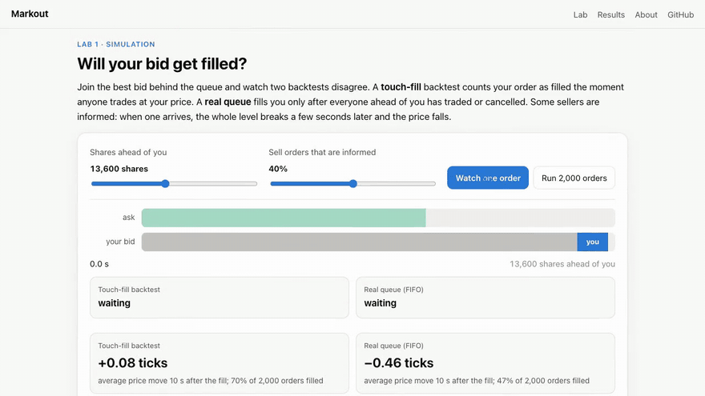
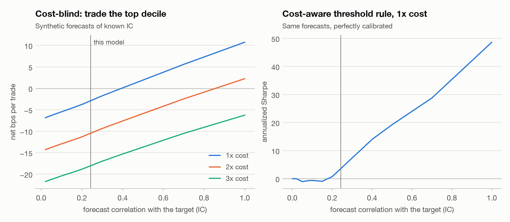
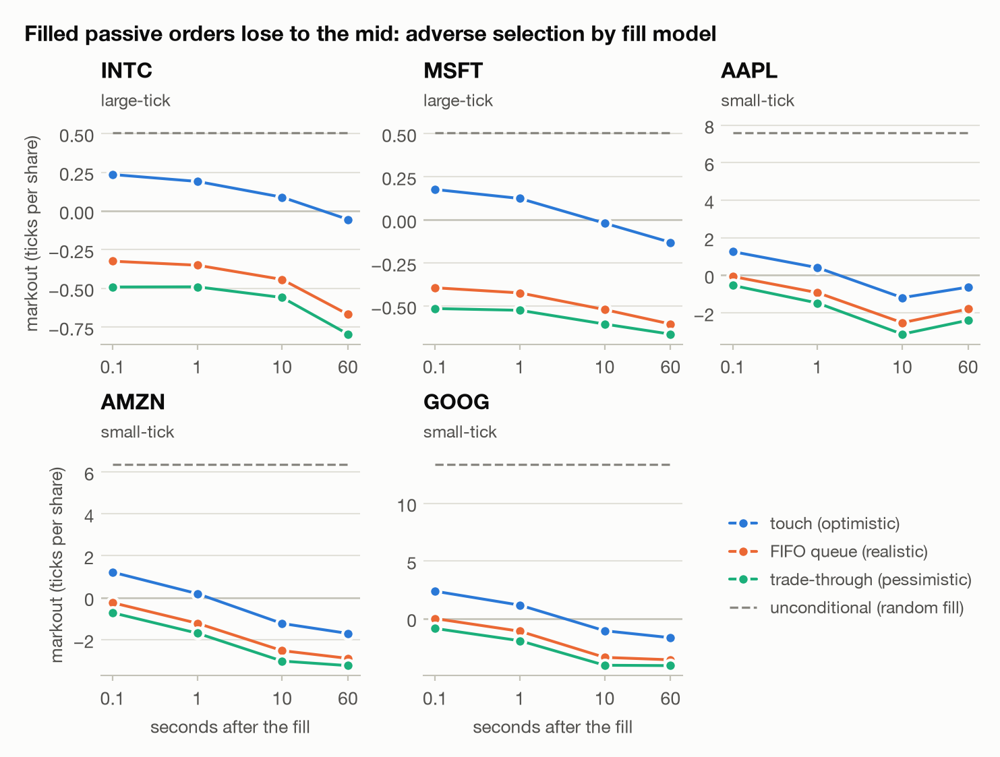
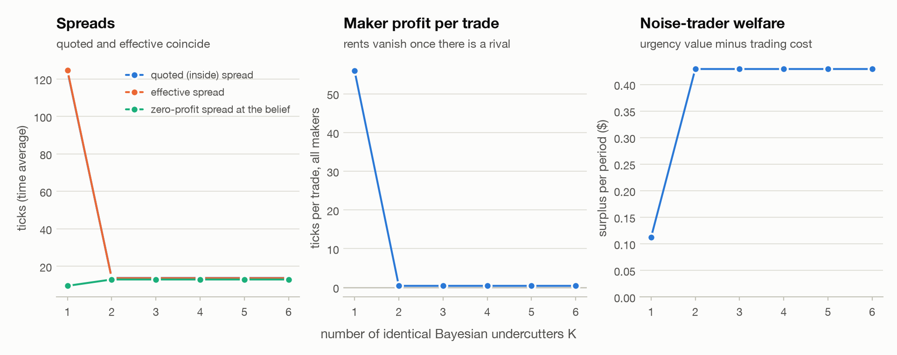
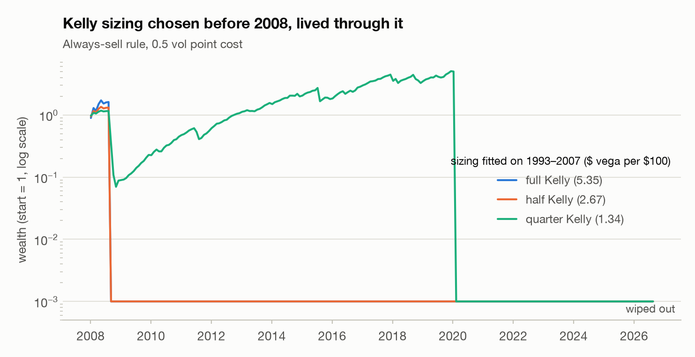
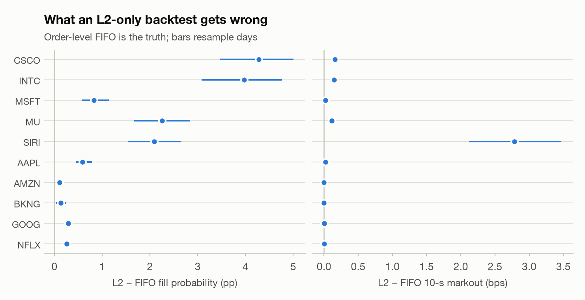
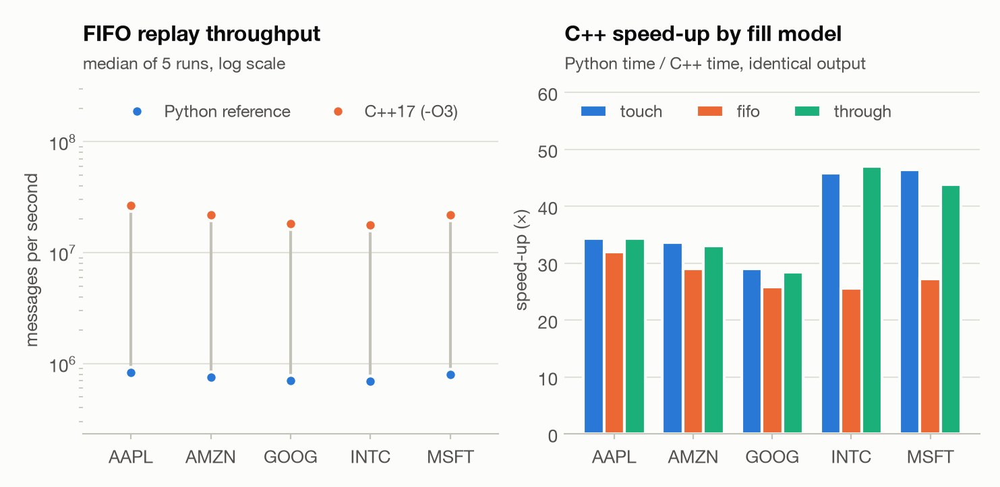
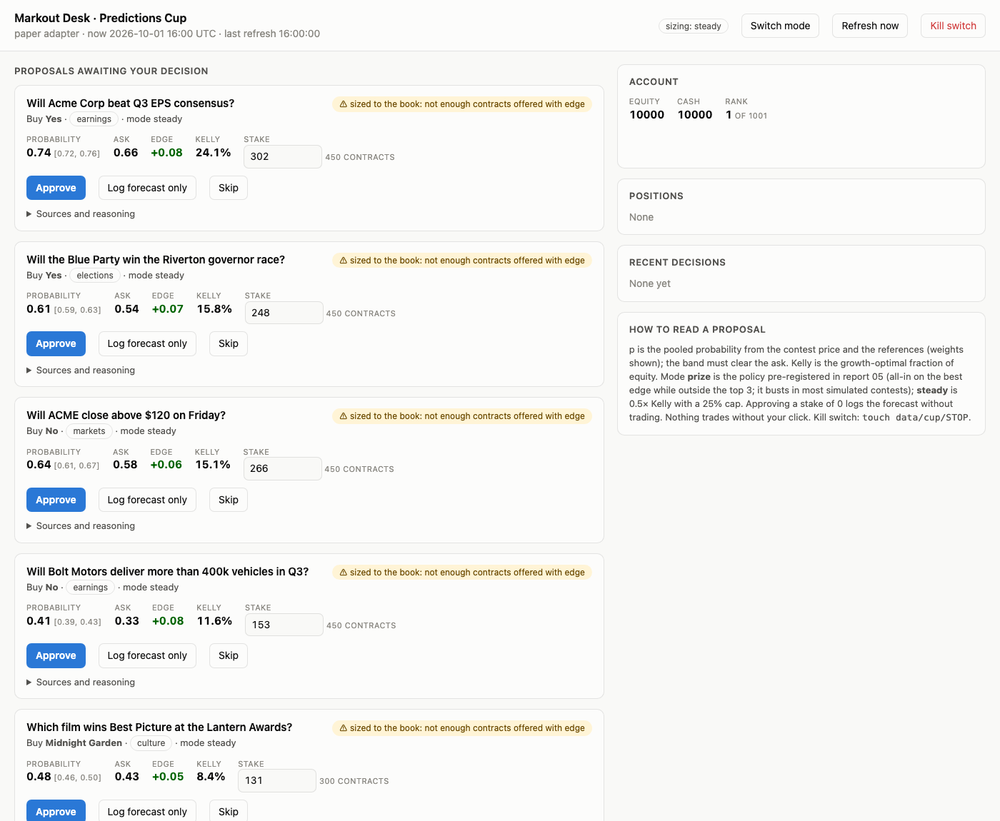

# Markout

[](https://github.com/tanaymihani/markout/actions/workflows/tests.yml) [](https://github.com/tanaymihani/markout/actions/workflows/codeql.yml) [](LICENSE)

Does a short-horizon trading edge survive the spread, realistic fills, competing traders, and the bias that comes from trying many strategies? This repo is my attempt to find out, step by step, on real market data where I could get it.

**Live labs:** [tanaymihani.github.io/markout](https://tanaymihani.github.io/markout/) has four interactive labs, a market-making game and the [trading desk](https://tanaymihani.github.io/markout/desk/), all running in the browser.

[](https://tanaymihani.github.io/markout/)

The name comes from the *markout*, the price move right after a trade, which market makers use to check whether they got picked off. The same trap shows up at every stage here: the best of many backtests looks better than it is, and so do the order that happened to get filled and the bet where you disagree most with the market. Each part tries to measure that gap and correct for it.

## In brief

- **Closing auction.** A LightGBM model beats a per-stock baseline on every out-of-sample day. Over 240 walk-forward days, traded net of costs at a size the order book can absorb, it has an annualized Sharpe of 4.8 but nets only $2,041, because costs take 61% of the gross; at twice the assumed costs the Sharpe is -0.2. On a 60-day holdout I opened once, the frozen model scored 4.7 ($1,101): real, but thin.
- **Fills.** Resting orders in INTC look profitable if any trade at your price fills you (+0.33 bps ten seconds later). Simulating queue position order by order turns that into -1.64 bps: the fills you actually get are the ones you didn't want.
- **Fills across days.** On 10 NASDAQ ITCH sample days of 2019–2021 and 10 stocks (3.5 billion messages), the real queue makes the markout worse than a touch-fill backtest on 100% of stock-days, by 0.34 bps for the median stock. The 2012 sign flip is not general: on these days touch fills already show a loss for 8 of the 10 stocks. A backtest that only sees aggregated depth overstates the fill rate by 1.5 points on average.
- **Competition.** A lone market maker quotes a 124-tick spread; one identical rival brings it to 13.8, next to the zero-profit 13.0. Competition removes the rent, not the cost of trading against informed flow.
- **Volatility premium.** VIX sat above the volatility that followed 86% of the time since 1990, but the textbook Kelly formula asks for 3.0x the growth-optimal size, and every Kelly fraction fitted on 1993–2007 was wiped out after 2008. Selling delta-hedged straddles instead of variance cuts the worst month from 79 to 41 per $1 of vega, though at-the-money options carry less of the premium.
- **Contest sizing.** In a simulated 1,000-player contest that pays only the top 3, 1x Kelly never finishes in the money over 10,000 runs. The best policy tried (0.5x Kelly, all-in in the last 80% of rounds if outside top 3) gets there 2.4% of the time, 8x a random player's odds, and busts in 96% of runs.

## Contents

| Part | Question | Data |
|---|---|---|
| [01 Closing auction](reports/01_auction.md) | Can a model predict 60-second moves in the NASDAQ closing auction well enough to pay the spread? | Optiver *Trading at the Close* (Kaggle): 200 stocks, 481 days |
| [02 Microstructure](reports/02_microstructure.md) | Does an order-book signal survive realistic queue-position fills? | LOBSTER sample: five NASDAQ stocks, one day, every order |
| [03 Arena](reports/03_arena.md) | What does competition between market makers do to spreads and profits? | Simulated markets: Glosten–Milgrom, Kyle, a market-making tournament, Kuhn poker |
| [04 Options](reports/04_options.md) | What does delta hedging actually earn, and how often should you hedge? | Simulation, plus one SPY option chain |
| [05 Predictions Cup](reports/05_predictions_cup.md) | How should you size bets when only the top three places get paid? | Simulation of SIG's student contest |
| [06 Volatility premium](reports/06_vol_premium.md) | How big is the premium in S&P options, when does selling it blow up, and how much should you sell? | S&P 500, VIX and VIX3M daily closes, 1990 onward |
| [07 Many days](reports/07_many_days.md) | Does the fill gap from 02 hold across days and stocks? | NASDAQ TotalView-ITCH 5.0 sample days, 2019–2021: ten days, ten stocks |
| [08 L2 and latency](reports/08_l2_and_latency.md) | How wrong is a backtest that only sees aggregated depth, and what does latency cost? | The days of 07 |

There is also a trading desk for SIG's Predictions Cup, and a C++ version of the order-book replay from part 02.

## Results

The paragraphs below are copied from the reports.

**01 · Closing auction.** The best model (lgbm[all, 63 leaves]) cuts out-of-sample MAE by 2.18% versus the per-stock median (IC 0.184; Diebold–Mariano p < 0.001). Turned into trades at 1x cost, the selected policy's research-period PnL is positive and its 95% bootstrap CI excludes zero: annualized Sharpe 4.81 (95% CI 3.34 to 6.28), 22.3 trades a day, 2.27 bps net per trade. The edge is about one spread wide: at 2x cost the same rule's Sharpe is -0.209 and it stops paying. It is also small: the displayed-depth cap binds on 99.5% of trades, the average trade is $1,683, and the research period nets $2,041 in total. Deflated for 18 effective trials (of 32), the Deflated Sharpe Ratio is 0.853 and PBO is 0.059: suggestive, but below the usual 0.95 bar once the search is accounted for. On the holdout (days 421–480, scored once), the same frozen policy nets $1,101 over 60 days (annualized Sharpe 4.74).

<picture>
  <source media="(prefers-color-scheme: dark)" srcset="reports/figures/b_voi_dark.png">
  
</picture>

**02 · Microstructure.** Queue imbalance predicts the next price move, but does trading on it pay once fills follow queue priority? No. Chosen before 12:45 and scored after, the best post-or-cross rule under FIFO fills earns AAPL -0.192, AMZN -0.051, GOOG -0.158, INTC +0.002 and MSFT +0.003 ticks per decision: reliably negative for GOOG; indistinguishable from zero for AAPL, AMZN and MSFT; positive for INTC only because it trades on 1% of decisions for +0.25 ticks each, which a 0.3-tick taker fee wipes out. Touch fills would have said yes: INTC +0.069 ticks per decision, confidence interval above zero.

<picture>
  <source media="(prefers-color-scheme: dark)" srcset="reports/figures/d_markouts_dark.png">
  
</picture>

**03 · Arena.** Competition takes away the market maker's rents, but not the cost of adverse selection. In a Glosten–Milgrom market with elastic noise demand, a lone Bayesian undercutter quotes a time-average spread of 124 ticks and earns 22.7 dollars per episode. One identical rival brings the spread down to 13.8 ticks, 0.8 ticks above the zero-profit spread at the same beliefs. Maker profit falls from 55.9 to 0.4 ticks per trade, and noise-trader welfare rises from 0.112 to 0.429 dollars per period. A naive fixed tight quote loses 1.31 dollars per episode alone and 3.51 in the free-for-all. There it wins 98.2% of the fills in the first 10 periods, while V is still uncertain. Each of those fills carries 18.3 ticks of adverse selection against its 5.44-tick edge: the quote that wins the flow is the one that was too cheap. The round-robin winner is the undercutter.

<picture>
  <source media="(prefers-color-scheme: dark)" srcset="reports/figures/e_arena_competition_dark.png">
  
</picture>

**04 · Options.**

- Pricing engine: put–call parity holds to 4e-16 of the strike, Greeks match finite differences to 2e-06 relative, and IVs round-trip to 2e-10.
- Short 30-day ATM call sold at σ_imp = 20% and hedged every 5 min with σ_real = 15%: mean PnL +$0.6856 ± 0.0016 vs C(σ_imp) − C(σ_real) = +$0.6841. Short gamma earns when realized < implied.
- Hedging-error std falls like N^-0.49 (theory: 1/√N) while turnover grows like N^0.52. The best frequency for cost + 1 × std moves from 5 min (κ = 0 bp) to 1 day (κ = 10 bp).
- The gamma–theta attribution explains 99.98% of hedged-PnL variance path by path at 5 min hedging (corr 0.9999).
- SPY (yfinance, 2026-09-29 16:15 ET): ATM IV 12.0% at 7 days, 13.4% at 31 days, 14.1% at 93 days. Parity 'fails' for 367 of 370 strike pairs at mids, 64 after crossing the spread, and 6 against the American band.

**05 · Predictions Cup sizing.** The winning bankroll has a median of 92× the start (10th–90th percentile 19×–691×), and third place needs a median 35×. 31% of contests were won by a field player going all-in every round, and 2% by one of the sharp players. Your median at 0.75× Kelly is 1.40×, and at 1× Kelly you reach the top 3 in none of the 10,000 simulated contests. In a 1,000-player field over 40 markets, forecasting skill does not move you up the ranking; variance does.

**06 · Volatility premium.** From 1990 to 2026, VIX exceeded the volatility the S&P then realized over the next 21 trading days 85.9% of the time, by 4.10 vol points on average (median 4.71). Selling one month of variance every month since 2006 earned an annualized Sharpe of 0.551 with a skew of -4.36: its worst month (2008-10-01) lost 66.6 per $1 of vega, against an average gain of 1.56. The best of 5 timing rules, *har + contango*, raises the Sharpe to 1.07 (95% CI 0.408 to 2.30) and cuts the maximum drawdown from 136 to 60.9, and it survives the deflation for the 5 rules tried (Deflated Sharpe 0.965). Sizing matters more than timing: the textbook Kelly fraction mu/sigma^2 asks for 2.96x the growth-optimal size on these fat-tailed outcomes, 2.55x the size at which the worst month wipes out the account. Collected with a delta-hedged straddle instead, the worst month of 1993–2026 loses 41.1 rather than 78.9 per $1 of vega, because the straddle's exposure fades once the index leaves the strike. But at-the-money options trade below VIX, and at a 2-point discount the straddle's Sharpe (0.752) is below the variance swap's over the same months (0.898).

<picture>
  <source media="(prefers-color-scheme: dark)" srcset="reports/figures/h_kelly_dark.png">
  
</picture>

**07 · Many days.** Does the gap from 02 survive ten more days and ten stocks? Across 100 stock-days, the touch-fill markout ten seconds after a fill is higher than the FIFO-queue markout on 100% of them. The median stock's gap is +0.34 bps; averaged across the stocks each day it is +1.21 [+1.10, +1.31] bps (mean, and a 95% interval that resamples days), pulled up by SIRI, a $6 stock whose one-cent tick is worth about 16 bps. On these days a touch-fill backtest already shows a loss after the fill for 8 of 10 stocks, so the sign flip of report 02 (INTC in 2012: +0.33 bps under touch fills, -1.64 under FIFO, a gap of 1.97; here +0.39) is not the general case. What holds on every stock-day is the direction: the real queue makes the markout worse.

<picture>
  <source media="(prefers-color-scheme: dark)" srcset="reports/figures/g_gap_heatmap_dark.png">
  
</picture>

**08 · L2 backtests and latency.** An L2-only backtest is optimistic: it overstates the fill probability by 1.5 [1.3, 1.6] percentage points against the order-level answer. 1.5% of orders fill under the L2 estimate but not in the queue, against 0.0% the other way round; the two agree on whether an order fills for 98.4% of orders. Latency matters less than queue position: compared with no delay, 20 ms costs 0.2 pp of fill probability and 500 ms costs 2.7 pp, mostly through orders rejected because the market moved before they arrived.

<picture>
  <source media="(prefers-color-scheme: dark)" srcset="reports/figures/i_l2_error_dark.png">
  
</picture>

**C++.** The order-book replay and queue simulator from part 02 is sequential and keeps state, so it was the one piece worth porting. `cpp/queue_sim.cpp` (C++17 with pybind11) runs 26–47× faster than the Python version and gives identical output, checked on all five stocks and on randomized event streams.

<picture>
  <source media="(prefers-color-scheme: dark)" srcset="reports/figures/g_throughput_dark.png">
  
</picture>

## The Predictions Cup desk

SIG runs a free prediction-market contest for students (Oct 1 to Nov 4, 2026), and its rules allow bots as long as each person keeps one account and stays within the platform's limits. I built this desk for it. It runs on a laptop, uses only free public data, and never trades without a click.

- It looks up reference prices for each contest market: real-money prices from Polymarket and Kalshi, option-implied probabilities for stock-price questions, and earnings-beat history. Every suggested match between a contest market and a reference has to be confirmed by hand, because matching is where things quietly go wrong.
- It pools those references with the contest's own price in log-odds, so it never treats a single reference as the truth.
- It proposes a trade only when the whole uncertainty band clears the ask. Size comes from Kelly as a target exposure (either the pre-registered contest policy from part 05, or a steadier half-Kelly), capped by what the order book can fill right now. Nothing is left resting on the book.
- Every decision, including the ones I skip, goes into a journal that scores my forecasts against the market once the questions resolve.



The [demo](docs/demo/DEMO.md) runs the whole loop offline on made-up markets (`make demo`); `make desk` starts it on a paper contest at http://127.0.0.1:8765. The [matcher dry run](docs/demo/DRYRUN.md) tests the matching against live Polymarket and Kalshi questions. Its first version mostly suggested look-alikes (the other team, another stat line, a different threshold); those cases are now tests.

**[Open the desk in your browser](https://tanaymihani.github.io/markout/desk/).** It runs on a fictional 8-market scenario: Pyodide (Python compiled to WebAssembly) executes the desk's own Python in the tab, so every visitor gets a private paper-trading sandbox, with its own exchange, journal and clock, and nothing is sent anywhere. `python -m markout.cup public` (or the Docker image) serves the same sandboxes from one server, with header sessions, eviction and expiry, rate limits and a strict Content-Security-Policy; [ARCHITECTURE.md](ARCHITECTURE.md) has the details and [deploy/README.md](deploy/README.md) the deployment.

## How I tried to keep it honest

- 429 tests (`make test`). One of them corrupts every future row of the auction data and checks that no feature of the past changes; a deliberately leaky feature fails it, so the test does catch leaks.
- Walk-forward splits by day, never random rows. Labels never cross a day, so there is nothing to purge; `src/markout/auction/cv.py` explains why.
- Every variant I tried is logged with its config, daily PnL and git commit, including the losers, so the Deflated Sharpe and PBO count all of the searching. (The 32 auction trials were logged from a working copy whose commit predates this repository's public history, so their SHAs don't resolve on GitHub.)
- The auction holdout sits behind a guard that refuses a second look (it has been opened 1 time).
- The tests check known answers from theory: the Glosten–Milgrom spread, Kyle's λ, the value of Kuhn poker, put–call parity and the Greeks. Published empirical results are in the table below.
- `make report` regenerates every report and figure from fixed seeds, so the numbers in the text are never typed by hand.

### Replications

Published numbers next to the ones this code gets on its own data (`python -m markout.replications`). Where the setups differ, the last column says how.

| result | published | here | setup |
|---|---|---|---|
| Deflated Sharpe worked example ([Bailey & López de Prado (2014), *J. Portfolio Management* 40(5), the numerical example](https://www.davidhbailey.com/dhbpapers/deflated-sharpe.pdf)) | SR₀ 0.1132; DSR 0.9004 at N = 100, 0.9505 at N = 46, 0.9505 for normal returns at N = 88 | 0.1132; 0.9004, 0.9505, 0.9505 ([tests](tests/test_evaluation_dsr.py)) | Same inputs; equal to the printed four decimals. |
| Order-flow imbalance explains the same 10 s price change ([Cont, Kukanov & Stoikov (2014), *J. Financial Econometrics* 12(1), Tables 2 and 3](https://arxiv.org/abs/1011.6402)) | average R² 0.65 (50 NYSE stocks, TAQ quotes and trades, April 2010) | 0.63, from 0.41–0.87 by stock ([report 02](reports/02_microstructure.md)) | Five NASDAQ stocks on one LOBSTER day (2012); same buckets and half-hour windows. |
| Price impact is inversely proportional to depth (same paper) | λ = 0.98 [0.88–1.08] in log β = a − λ log depth, fitted stock by stock | 0.90 [0.45–1.36] within stocks; 1.27 [1.20–1.34] pooled across them ([report 02](reports/02_microstructure.md)) | They fit each stock across its windows, so the within-stock slope is the comparable one: its interval and theirs contain 1, the pooled one does not. |
| Queue imbalance predicts the next mid-price move, better for large-tick stocks ([Gould & Bonart (2016), *Market Microstructure and Liquidity* 2(2), Tables 2 and 4](https://arxiv.org/abs/1512.03492)) | out-of-sample AUC 0.752–0.805 large-tick, 0.581–0.642 small-tick; logistic slope 2.03–2.73 vs 0.50–0.85 (10 Nasdaq stocks, LOBSTER, all of 2014) | AUC 0.652–0.661 vs 0.531–0.569; slope 1.12–1.33 vs 0.23–0.35 ([report 02](reports/02_microstructure.md)) | Same imbalance and target. One 2012 day, sampled every second and split by time of day; the ordering holds, the levels are lower. |
| Optiver *Trading at the Close*, MAE on the same holdout days ([a public repository](https://github.com/andrew-somerset/optiver-trading-at-the-close)) | median baseline 5.815, gradient boosting 5.708 bps | median 5.818, LightGBM 5.693 ([report 01](reports/01_auction.md)) | The matching baseline checks the data and the split. |
| S&P 500 variance risk premium, 1996-01 to 2003-02 ([Carr & Wu, *Variance Risk Premia*, May 2004 working paper (published in *RFS* 22(3), 2009), Tables 4 and 5, SPX row](https://econwpa.ub.uni-muenchen.de/econ-wp/fin/papers/0409/0409015.pdf)) | realized vol 18.82 vs swap rate 24.41; mean 100·(RV − SW) -2.279 (t = -7.19); mean ln(RV/SW) -0.594 (t = -9.48) | 18.96 vs 23.73; -1.857 (t = -6.42); -0.525 (t = -9.61) ([code](src/markout/replications.py), data of [report 06](reports/06_vol_premium.md)) | VIX² stands in for their option-built swap rate; realized variance over the next 21 trading days; Newey–West t with 30 lags, as theirs. |

## Use it on your own data

The tools under the reports work on other data too. `markout fills` runs the three fill models on any LOBSTER day, and `markout sharpe` and `markout pbo` check a backtest against the search that produced it:

```bash
markout fills AAPL_2012-06-21_34200000_57600000_message_10.csv AAPL_2012-06-21_34200000_57600000_orderbook_10.csv
markout sharpe pnl.csv --trials 50 --sr-var 0.0009   # bootstrap CI, PSR and the Deflated Sharpe
markout pbo trials.csv --index date                  # probability of backtest overfitting
markout kelly --p 0.62 --price 0.55 --fraction 0.5
```

[USAGE.md](USAGE.md) covers the command line and the Python API (fill simulation, the Deflated Sharpe, PBO, the trial registry, the holdout guard, Kelly, Black–Scholes and hedging). Its examples run in the test suite, so they stay correct. The [API reference](https://tanaymihani.github.io/markout/api/) documents every module (`make api-docs`).

## Running it

```bash
make install     # editable install into .venv
make lobster     # LOBSTER sample day (5 stocks, 10 levels)
make optiver     # Optiver data (needs a Kaggle login and the competition rules accepted)
make vol         # S&P 500 and VIX history for report 06
make itch        # ten NASDAQ ITCH sample days (about 45 GB) for reports 07 and 08
make cpp         # C++ extension (optional; there is a pure-Python fallback)
make test
make report      # regenerate every report, figure and results file
make demo        # the desk's offline demo
make desk        # the desk on a paper contest, http://127.0.0.1:8765
make public-desk # the hosted desk, one sandbox per visitor, http://127.0.0.1:7860
make docker      # the hosted desk's image (docker run --rm -p 7860:7860 markout-desk)
make demo-video  # re-record the site's demo video (needs the demo extra)
```

Also: `python -m markout.backtest.report` prints the daily PnL of the chosen auction strategy, `python -m markout.games.cardgame` is a market-making practice game, and `python -m markout.decision.journal init|add|score` manages the contest journal.

## Development

```bash
make check       # what CI runs: ruff, mypy, the tests and the browser tests
make cov         # coverage report (htmlcov/)
make lock        # re-resolve requirements.lock after changing dependencies
pre-commit install
```

CI installs the exact versions in `requirements.lock` and runs lint, types, the tests with a coverage floor, browser tests in Chrome and a smoke test of the desk's container; CodeQL scans the code. [ARCHITECTURE.md](ARCHITECTURE.md) explains how the pieces fit together and how each is tested, and [CHANGELOG.md](CHANGELOG.md) lists the releases.

## Layout

```
src/markout/auction/     closing-auction data, audit, features, walk-forward models, report 01
src/markout/backtest/    costs, decision rule, sizing, daily PnL
src/markout/decision/    calibration, value of information, Kelly, contest study, journal
src/markout/evaluation/  trial registry, Deflated Sharpe, PBO, bootstrap, holdout guard, Diebold–Mariano
src/markout/lob/         LOBSTER parser, order-flow imbalance, fill simulator, markouts, report 02
src/markout/games/       Glosten–Milgrom, Kyle, market-making arena, Kuhn CFR, card game, report 03
src/markout/options/     Black–Scholes, delta hedging, SPY smile, report 04
src/markout/vol/         S&P 500 / VIX data, variance risk premium, HAR forecast, sizing, hedged straddles, report 06
src/markout/cup/         Predictions Cup desk: sources, matcher, estimates, sizing, paper exchange, local and hosted desk
src/markout/cli.py       the markout command
cpp/                     C++17 queue simulator and pybind11 bindings
reports/                 generated reports, figures (light and dark) and results
docs/                    the site (GitHub Pages), the desk in the browser (docs/desk/), the API reference
deploy/                  the hosted desk's pinned requirements and Hugging Face Space card
tests/                   pytest suite; tests/e2e/ drives a browser, tests/js/ runs the site's labs in Node
```

## Data

- **Optiver *Trading at the Close*** (Kaggle). Kaggle's rules don't allow redistributing it, so it is downloaded by `make optiver` and never committed.
- **LOBSTER sample files** for AAPL, AMZN, GOOG, INTC and MSFT on 2012-06-21. The official download links stopped working when lobsterdata.com was rebuilt, so the script tries them first and otherwise uses a pinned, hash-checked mirror. A replay that checks every message against the book is the authenticity check. Not committed.
- **One SPY option chain**, saved with yfinance on 2026-09-29 after the close.
- **S&P 500, VIX and VIX3M daily closes** from Yahoo Finance (`make vol`). Not committed.
- **NASDAQ TotalView-ITCH 5.0 sample days** from emi.nasdaq.com: ten full days of 2019–2021 (`make itch`, about 45 GB), converted to LOBSTER format for ten stocks by `markout.lob.itch`, with every execution, cancel, delete and replace matched to an earlier order (checked for every symbol in the files too: 1.9 billion references, none unmatched). Not committed.

## Limitations

Each report ends with its own. The main ones: the auction target is measured against a synthetic index, so the PnL assumes a hedge I can't observe; report 02 is a single day from 2012 (07 adds ten NASDAQ sample days of 2019–2021, on NASDAQ's book only) and my own orders have no market impact; the arena is a stylized dealer market where everyone shares one belief; and the contest study has to assume the field size and the number of markets.

## License

MIT, see [LICENSE](LICENSE). The datasets keep their own terms and are not redistributed here.

