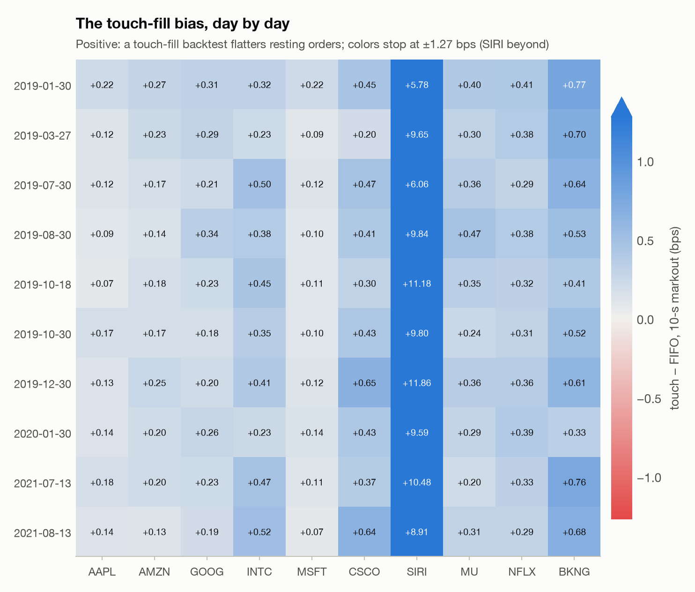
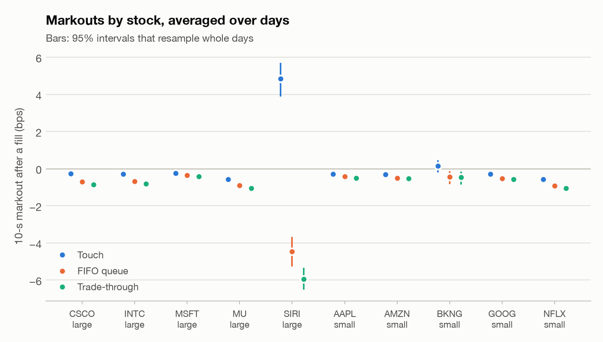

# 07 · Many days: does the fill gap hold?

*Generated by `python -m markout.lob.multiday` from 10 NASDAQ ITCH sample days (2019-01-30 to 2021-08-13) and 10 stocks.*

## The question

Report 02 found, on one day of 2012 LOBSTER data, that a backtest which fills a resting order whenever the market touches its price credits it with a positive markout, while simulating its place in the queue turns that negative. One day and five stocks cannot say whether that is a property of limit orders or of that day. Here the same experiment runs on every NASDAQ ITCH sample day available, for ten stocks.

**Answer.** Across 100 stock-days, the touch-fill markout ten seconds after a fill is higher than the FIFO-queue markout on 100% of them. The median stock's gap is +0.34 bps; averaged across the stocks each day it is +1.21 [+1.10, +1.31] bps (mean, and a 95% interval that resamples days), pulled up by SIRI, a $6 stock whose one-cent tick is worth about 16 bps. On these days a touch-fill backtest already shows a loss after the fill for 8 of 10 stocks, so the sign flip of report 02 (INTC in 2012: +0.33 bps under touch fills, -1.64 under FIFO, a gap of 1.97; here +0.39) is not the general case. What holds on every stock-day is the direction: the real queue makes the markout worse.

## By stock

| stock | tick | price $ | spread (ticks) | days | P(fill) touch | P(fill) FIFO | touch mk10 (bps) | FIFO mk10 (bps) | gap (bps), 95% CI | days gap > 0 |
|---|---|---|---|---|---|---|---|---|---|---|
| CSCO | large | 50 | 1.01 | 10 | 0.70 | 0.62 | -0.28 | -0.72 | +0.44 [+0.35, +0.52] | 100% |
| INTC | large | 54 | 1.01 | 10 | 0.75 | 0.68 | -0.30 | -0.68 | +0.39 [+0.32, +0.44] | 100% |
| MSFT | large | 168 | 1.35 | 10 | 0.85 | 0.83 | -0.25 | -0.37 | +0.12 [+0.10, +0.15] | 100% |
| MU | large | 52 | 1.06 | 10 | 0.80 | 0.76 | -0.58 | -0.91 | +0.33 [+0.28, +0.37] | 100% |
| SIRI | large | 6 | 1.00 | 10 | 0.25 | 0.09 | +4.84 | -4.47 | +9.31 [+8.10, +10.41] | 100% |
| AAPL | small | 215 | 2.14 | 10 | 0.84 | 0.82 | -0.28 | -0.42 | +0.14 [+0.11, +0.16] | 100% |
| AMZN | small | 2,136 | 62.43 | 10 | 0.63 | 0.61 | -0.31 | -0.50 | +0.19 [+0.17, +0.22] | 100% |
| BKNG | small | 1,986 | 183.81 | 10 | 0.31 | 0.27 | +0.14 | -0.45 | +0.60 [+0.51, +0.68] | 100% |
| GOOG | small | 1,535 | 65.45 | 10 | 0.50 | 0.47 | -0.30 | -0.54 | +0.24 [+0.21, +0.28] | 100% |
| NFLX | small | 360 | 13.85 | 10 | 0.66 | 0.64 | -0.58 | -0.93 | +0.35 [+0.32, +0.37] | 100% |

<picture>
  <source media="(prefers-color-scheme: dark)" srcset="figures/g_gap_heatmap_dark.png">
  
</picture>

<picture>
  <source media="(prefers-color-scheme: dark)" srcset="figures/g_markouts_by_stock_dark.png">
  
</picture>

Large-tick stocks (INTC, MSFT, CSCO, SIRI, MU) have long queues at the best price, so the queue decides which orders fill; small-tick stocks (AAPL, AMZN, GOOG, NFLX, BKNG) quote wider spreads in ticks and thinner queues. Some stocks sit near the line between the two: AAPL is small-tick on 7 of its 10 days and MSFT is large-tick on 7 of its 10 days. Each is pooled with the class of most of its days.

## The post-or-cross rule, out of sample by day

Report 02 chose the rule on a morning and scored it on the same afternoon. Here it is chosen on every other day and scored on the day left out, in ticks per share per decision (crossing pays the 0.3-tick access-fee cap in the net column).

| stock | model | rule, out of sample | net of the fee | always post | always cross | posts | crosses |
|---|---|---|---|---|---|---|---|
| AAPL | Touch | +0.000 [+0.000, +0.000] | +0.000 [+0.000, +0.000] | -0.451 | -0.865 | 0% | 0% |
| AAPL | FIFO queue | +0.000 [+0.000, +0.000] | +0.000 [+0.000, +0.000] | -0.667 | -0.865 | 0% | 0% |
| AMZN | Touch | -0.068 [-0.205, +0.000] | -0.068 [-0.205, +0.000] | -4.067 | -29.153 | 0% | 0% |
| AMZN | FIFO queue | +0.000 [+0.000, +0.000] | +0.000 [+0.000, +0.000] | -5.911 | -29.153 | 0% | 0% |
| GOOG | Touch | -0.065 [-0.175, +0.000] | -0.065 [-0.175, +0.000] | -1.809 | -32.592 | 1% | 0% |
| GOOG | FIFO queue | +0.000 [+0.000, +0.000] | +0.000 [+0.000, +0.000] | -2.867 | -32.592 | 0% | 0% |
| INTC | Touch | -0.004 [-0.006, -0.002] | -0.016 [-0.020, -0.012] | -0.086 | -0.336 | 4% | 4% |
| INTC | FIFO queue | -0.001 [-0.003, +0.001] | -0.013 [-0.016, -0.009] | -0.191 | -0.336 | 0% | 4% |
| MSFT | Touch | -0.009 [-0.024, -0.001] | -0.009 [-0.024, -0.001] | -0.325 | -0.545 | 1% | 0% |
| MSFT | FIFO queue | +0.000 [+0.000, +0.000] | +0.000 [+0.000, +0.000] | -0.472 | -0.545 | 0% | 0% |
| CSCO | Touch | -0.004 [-0.007, -0.001] | -0.011 [-0.018, -0.004] | -0.067 | -0.348 | 4% | 2% |
| CSCO | FIFO queue | -0.003 [-0.005, -0.000] | -0.015 [-0.021, -0.010] | -0.158 | -0.348 | 0% | 4% |
| SIRI | Touch | +0.019 [+0.011, +0.028] | +0.019 [+0.011, +0.028] | +0.019 | -0.461 | 99% | 0% |
| SIRI | FIFO queue | -0.000 [-0.000, +0.000] | -0.000 [-0.000, +0.000] | -0.008 | -0.461 | 0% | 0% |
| MU | Touch | +0.001 [-0.004, +0.007] | -0.010 [-0.016, -0.003] | -0.205 | -0.369 | 0% | 4% |
| MU | FIFO queue | +0.001 [-0.004, +0.007] | -0.010 [-0.016, -0.003] | -0.307 | -0.369 | 0% | 4% |
| NFLX | Touch | +0.000 [+0.000, +0.000] | +0.000 [+0.000, +0.000] | -1.225 | -6.371 | 0% | 0% |
| NFLX | FIFO queue | +0.000 [+0.000, +0.000] | +0.000 [+0.000, +0.000] | -1.772 | -6.371 | 0% | 0% |
| BKNG | Touch | -0.120 [-0.703, +0.407] | -0.120 [-0.703, +0.407] | -0.782 | -88.523 | 37% | 0% |
| BKNG | FIFO queue | -0.006 [-0.019, +0.000] | -0.006 [-0.019, +0.000] | -2.516 | -88.523 | 0% | 0% |

Under FIFO fills no stock has a rule that makes money out of sample net of the fee. For 7 of 10 stocks the rule learned on the other days acts on fewer than 1% of decisions: both posting and crossing lose on average, so the best rule is to stay out. Where it does trade (INTC 4%, CSCO 4% and MU 4% of decisions), it earns between -0.003 and +0.001 ticks per decision before the fee and loses after it. Touch fills invent a profitable rule for SIRI: it posts on 99% of decisions and earns +0.019 [+0.011, +0.028] ticks per decision out of sample. Under the real queue the rule learned on the same days posts on 0%.

## The data and the engine

NASDAQ publishes a few full days of its TotalView-ITCH 5.0 feed as samples. `markout.lob.itch` streams each one (3.50 billion messages in all) and rebuilds the book of every stock above from the first order of the day. On every day, every execution, cancel, delete and replace matched an order added earlier (0 unmatched), and the books pass the same replay check as the LOBSTER sample. The converted days hold 65,930,017 order-book events in the regular session. Run over every stock in the files (`--audit`), the same check covers 1,891,875,478 references to earlier orders across 8,712 to 11,097 symbols a day: 0 unmatched, and no order is left on the book at the end of any day.

| day | ITCH messages | parse (s) | unmatched, 10 stocks | rows, 10 stocks | symbols | references, all symbols | unmatched, all symbols |
|---|---|---|---|---|---|---|---|
| 2019-01-30 | 368,366,634 | 210 | 0 | 7,706,581 | 8,714 | 198,421,862 | 0 |
| 2019-03-27 | 422,264,305 | 168 | 0 | 9,485,966 | 8,712 | 229,473,112 | 0 |
| 2019-07-30 | 282,229,684 | 102 | 0 | 5,314,400 | 8,849 | 151,329,039 | 0 |
| 2019-08-30 | 310,317,357 | 118 | 0 | 5,995,062 | 8,841 | 167,118,612 | 0 |
| 2019-10-18 | 302,347,067 | 118 | 0 | 6,894,899 | 8,887 | 163,073,157 | 0 |
| 2019-10-30 | 293,989,079 | 109 | 0 | 4,838,819 | 8,887 | 159,825,560 | 0 |
| 2019-12-30 | 268,744,780 | 105 | 0 | 5,079,155 | 8,906 | 144,610,481 | 0 |
| 2020-01-30 | 423,285,709 | 175 | 0 | 8,247,964 | 8,916 | 230,608,529 | 0 |
| 2021-07-13 | 459,781,103 | 186 | 0 | 7,556,309 | 10,936 | 241,871,086 | 0 |
| 2021-08-13 | 367,986,583 | 174 | 0 | 4,810,862 | 11,097 | 205,544,040 | 0 |

The C++ engine replays a full stock-day at a median of 32M (touch), 21M (fifo queue), 32M (trade-through) messages per second, on a laptop.

## Limitations

- These are NASDAQ's own sample days, not a random sample, all from the 2019-2021 penny-tick regime, and they show NASDAQ's book only, not the consolidated market.
- The hypothetical orders have no market impact, as in report 02.
- Hidden orders are invisible until they trade, so their queue position is not modelled.
- The day-level intervals rest on few days; they show the spread of results across days, not a population estimate.
