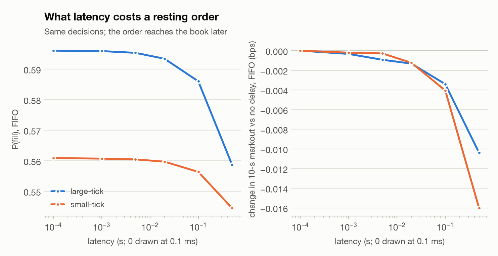

# 08 · How wrong is an L2 backtest, and what does latency cost?

*Generated by `python -m markout.lob.multiday` from 10 NASDAQ ITCH sample days (2019-01-30 to 2021-08-13) and 10 stocks, the data of report 07.*

**Answer.** An L2-only backtest is optimistic: it overstates the fill probability by 1.5 [1.3, 1.6] percentage points against the order-level answer. 1.5% of orders fill under the L2 estimate but not in the queue, against 0.0% the other way round; the two agree on whether an order fills for 98.4% of orders. Latency matters less than queue position: compared with no delay, 20 ms costs 0.2 pp of fill probability and 500 ms costs 2.7 pp, mostly through orders rejected because the market moved before they arrived.

## The question

Order-level data (every order id, as in ITCH or LOBSTER) lets a backtest know exactly where a resting order sits in the queue. Most backtests only have L2 data, the size at each price and the trades, and have to guess: when the size at our price drops without a trade, was the cancelled order ahead of us or behind? The usual guess is pro rata. Here that L2 estimate runs next to the order-level FIFO model on the same orders, so its errors can be measured directly. The same grid then runs with latency between the decision and the order reaching the book.

## An L2-only backtest

Averaged over stocks and days, the L2 fill probability minus the order-level one is +1.5 [+1.3, +1.6] percentage points (absolute error 1.5 [1.3, 1.6] pp), and the 10-s markout of its fills differs by +0.33 [+0.26, +0.39] bps (+0.02 for the median stock; SIRI's coarse tick dominates the average). It agrees with FIFO on whether an order fills at all for 98.4% of orders.

| stock | tick | P(fill) FIFO | L2 − FIFO, pp (95% CI) | markout L2 − FIFO, bps | same outcome | L2 fills, FIFO doesn't | FIFO fills, L2 doesn't |
|---|---|---|---|---|---|---|---|
| CSCO | large | 0.62 | +4.3 [+3.5, +5.0] | +0.16 [+0.13, +0.19] | 95.7% | 4.3% | 0.0% |
| INTC | large | 0.68 | +4.0 [+3.1, +4.8] | +0.15 [+0.12, +0.17] | 96.0% | 4.0% | 0.0% |
| MSFT | large | 0.83 | +0.8 [+0.6, +1.1] | +0.02 [+0.01, +0.03] | 99.1% | 0.9% | 0.0% |
| MU | large | 0.76 | +2.3 [+1.7, +2.8] | +0.12 [+0.09, +0.14] | 97.7% | 2.3% | 0.0% |
| SIRI | large | 0.09 | +2.1 [+1.5, +2.6] | +2.78 [+2.12, +3.47] | 97.9% | 2.1% | 0.0% |
| AAPL | small | 0.82 | +0.6 [+0.4, +0.8] | +0.02 [+0.01, +0.03] | 99.3% | 0.6% | 0.0% |
| AMZN | small | 0.61 | +0.1 [+0.1, +0.1] | +0.00 [-0.00, +0.00] | 99.8% | 0.2% | 0.1% |
| BKNG | small | 0.27 | +0.1 [+0.0, +0.3] | -0.00 [-0.00, +0.00] | 99.7% | 0.2% | 0.1% |
| GOOG | small | 0.47 | +0.3 [+0.2, +0.4] | +0.00 [+0.00, +0.01] | 99.6% | 0.3% | 0.0% |
| NFLX | small | 0.64 | +0.3 [+0.2, +0.3] | +0.00 [+0.00, +0.01] | 99.5% | 0.4% | 0.1% |

<picture>
  <source media="(prefers-color-scheme: dark)" srcset="figures/i_l2_error_dark.png">
  
</picture>

## Latency

The same decisions every 5 s, with the order reaching the book later: it joins the queue behind whatever arrived in the meantime, or is rejected if the market has moved through its price. Each stock is pooled with the tick class of most of its days, and markouts are shown as the change from no delay (their levels, by stock, are in report 07).

**Large-tick stocks.**

| latency | rejected | P(fill) FIFO | P(fill) touch | markout change, FIFO (bps) | markout change, touch (bps) |
|---|---|---|---|---|---|
| 0 ms | 0.0% | 0.596 | 0.670 | +0.000 | +0.000 |
| 1 ms | 0.0% | 0.596 | 0.669 | -0.000 | -0.000 |
| 5 ms | 0.1% | 0.595 | 0.669 | -0.001 | -0.000 |
| 20 ms | 0.3% | 0.593 | 0.667 | -0.001 | -0.001 |
| 100 ms | 1.0% | 0.586 | 0.659 | -0.003 | -0.003 |
| 500 ms | 3.7% | 0.559 | 0.631 | -0.010 | -0.005 |

**Small-tick stocks.**

| latency | rejected | P(fill) FIFO | P(fill) touch | markout change, FIFO (bps) | markout change, touch (bps) |
|---|---|---|---|---|---|
| 0 ms | 0.0% | 0.561 | 0.588 | +0.000 | +0.000 |
| 1 ms | 0.0% | 0.561 | 0.588 | -0.000 | -0.000 |
| 5 ms | 0.0% | 0.560 | 0.587 | -0.000 | -0.001 |
| 20 ms | 0.1% | 0.560 | 0.587 | -0.001 | -0.003 |
| 100 ms | 0.4% | 0.556 | 0.583 | -0.004 | -0.009 |
| 500 ms | 1.5% | 0.544 | 0.570 | -0.016 | -0.030 |

<picture>
  <source media="(prefers-color-scheme: dark)" srcset="figures/i_latency_dark.png">
  
</picture>

## Limitations

- Pro rata is one L2 assumption among several; backtesters also use pessimistic (cancels always behind) or probabilistic queue models, which would land elsewhere.
- Latency here delays placement and cancellation equally and leaves the decision's information unchanged; it does not model a faster rival reacting to the same signal.
- The orders have no market impact, and hidden liquidity is invisible until it trades.
